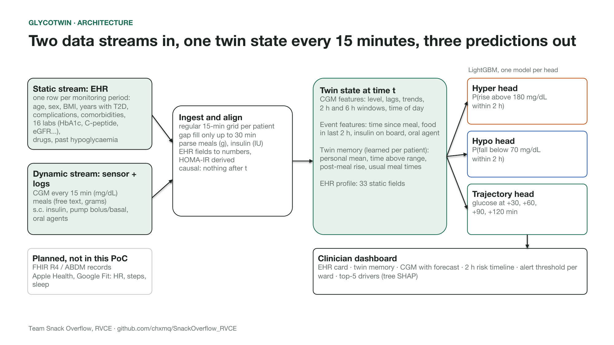
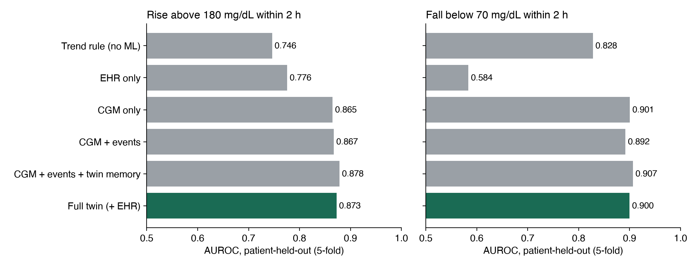
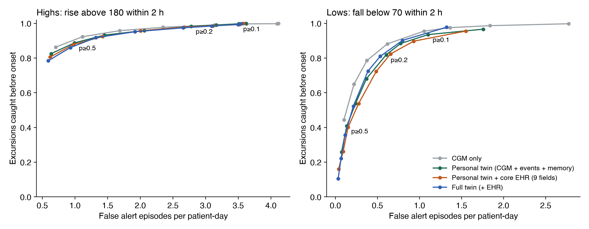
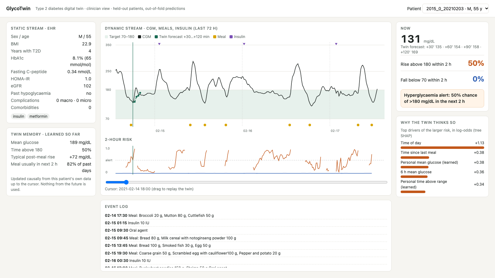

# GlycoTwin: a type 2 diabetes digital twin

**GlycoTwin fuses a patient's health record with their continuous glucose monitor (CGM) stream. It warns a clinician up to 2 hours before glucose rises above 180 mg/dL or falls below 70 mg/dL.**

Submission to the **Happiest Health Digital Twin Challenge 2026**, Phase 1 (Prototype & Code Submission).

| Deliverable | Link |
|---|---|
| Demo video (unlisted YouTube, ~18 min) | VIDEO_LINK_PENDING |
| Live clinician dashboard | https://chxmq.github.io/SnackOverflow_RVCE/ |
| Presentation (PDF / PPTX) | [`deliverables/GlycoTwin_Presentation.pdf`](deliverables/GlycoTwin_Presentation.pdf) · [`.pptx`](deliverables/GlycoTwin_Presentation.pptx) |
| Architecture diagram (PDF / PPTX) | [`deliverables/GlycoTwin_Architecture.pdf`](deliverables/GlycoTwin_Architecture.pdf) · [`.pptx`](deliverables/GlycoTwin_Architecture.pptx) |
| Video file (same as YouTube) | [`deliverables/GlycoTwin_Demo.mp4`](deliverables/GlycoTwin_Demo.mp4) |
| Licence | [MIT](LICENSE) (code) · dataset CC BY 4.0 |

---

## Team details

**Team name:** Snack Overflow

| Member | Role |
|---|---|
| Yash Saraogi | Team leader |
| Tallam Sri Sai Subramanyam | Member |
| Yash Gautam | Member |

## College / incubator information

- **College:** RV College of Engineering (RVCE), Bengaluru, Karnataka, India
- **Incubator:** none. We entered as a student team from RVCE.
- **Repository / folder name:** `SnackOverflow_RVCE` (Team Name_College Name, as the submission instructions ask)

## Project title

**GlycoTwin: a type 2 diabetes digital twin that warns two hours before glucose leaves the safe range**

## Problem statement

- About 101 million Indians live with diabetes and 136 million with prediabetes (ICMR-INDIAB, *Lancet Diabetes & Endocrinology*, 2023).
- The main number used to manage them, HbA1c, is a three-month average. It cannot say when glucose went high after lunch, or how low it fell at 3 am.
- A 15-minute CGM records 96 readings a day, which is 8,640 a quarter. No clinician can read that raw for a whole panel of patients.
- Both directions are dangerous:
  - **Hypoglycaemia** in patients on insulin or sulfonylureas is acute.
  - **Repeated post-meal spikes** are the slow driver of complications.

We scoped the twin to one condition prevalent in India, **type 2 diabetes**. Its adverse event is **a glucose excursion out of the 70–180 mg/dL target range within the next 2 hours**, predicted while glucose is still in range.

## Healthcare use case

A diabetes team (endocrinologist, diabetes educator, ward nurse) looks after a panel of CGM-wearing type 2 diabetes patients, in a ward or in remote monitoring after discharge.

| | What the twin does | What the clinician can do |
|---|---|---|
| Hyper alert | P(rise above 180 mg/dL within 2 h) | Check the meal, consider a correction dose, suggest a walk |
| Hypo alert | P(fall below 70 mg/dL within 2 h) | Offer a snack, hold the sulfonylurea or insulin dose |
| Twin view | Personal post-meal rise, usual meal times, personal mean and time above range | Tailor dose and diet advice |
| Explanation | Top 5 drivers per alert (tree SHAP) | Overrule an alert whose reason makes no clinical sense |

The twin is decision support. It does not dose or prescribe.

## Data, and how we follow the sandbox rules

We used **real, de-identified, openly licensed data** rather than only synthetic data. A model trained on our own simulator would mostly learn our simulator.

- **Dataset:** ShanghaiT2DM, from Zhao Q. *et al.*, "Chinese diabetes datasets for data-driven machine learning", *Scientific Data* 10, 35 (2023). Downloaded from figshare ([doi:10.6084/m9.figshare.20444397](https://doi.org/10.6084/m9.figshare.20444397)), licence **CC BY 4.0**. A copy is in `data/raw/` with attribution.
- **Size:** 100 people with type 2 diabetes, 109 monitoring periods, 112,287 CGM readings (15-min), ≈1170 patient-days.

| Stream | Content |
|---|---|
| **Static / historical (EHR)** | 33 fields per period. Demographics: age, sex, BMI, smoking, alcohol. Diabetes: years since diagnosis; acute, macro- and microvascular complications; comorbidities; hypoglycaemic and other drugs; past hypoglycaemia. 16 lab tests: FPG, 2 h PPG, fasting and 2 h C-peptide, fasting and 2 h insulin, HbA1c, glycated albumin, TC, TG, HDL, LDL, creatinine, eGFR, uric acid, BUN. Plus HOMA-IR (derived). |
| **Dynamic / real-time (IoT)** | CGM every 15 min (mg/dL), plus timestamped logs: meals (free text with grams), s.c. insulin (IU), insulin pump bolus and basal, oral agents. |

No identifiable patient data is used anywhere, which complies with the DPDP Act and HIPAA constraints in the brief. This dataset has **no heart rate, steps or sleep**; see *Limitations*.

## What makes it a twin

At every 15-minute step `t`, the twin keeps a state built **only from data at or before `t`**:

1. **CGM features:** current level, lags (15–120 min), 15/30/60-min trends, acceleration, 2 h and 6 h windows, time of day.
2. **Event features:** time since the last meal, grams of food in the last 2 h, size of the last meal, s.c. insulin in the last 4 h, pump bolus in the last 2 h, basal rate, oral agent in the last 4 h.
3. **Twin memory, learned per patient as data arrives:**
   - personal mean glucose;
   - personal time above 180;
   - personal glucose variability (CV);
   - personal post-meal rise, the mean peak rise over the 2 h after past meals. A meal is used only after its 2 h window has fully passed, so the label never leaks;
   - usual-meal habit, the share of past days with a meal logged in the next 2 h of clock time.
4. **EHR profile:** the 33 static fields.

Because the state is causal, the twin can be **replayed**. Dragging the dashboard cursor shows exactly what it knew and predicted at that moment.

## Architecture



The PDF is [`deliverables/GlycoTwin_Architecture.pdf`](deliverables/GlycoTwin_Architecture.pdf).

```
EHR summary (33 fields) ─┐
                         ├─► ingest & align on a 15-min grid (causal) ─► twin state(t) ─┬─► hyper head  P(>180 in 2 h)
CGM + meals + insulin ───┘                                                              ├─► hypo head   P(<70 in 2 h)
                                                                                        └─► trajectory  glucose at +30/60/90/120 min
                                                                    ▼
                                         clinician dashboard (EHR card, twin memory, CGM + forecast, risk timeline, top-5 reasons)
```

## Technical stack

| Layer | Tools |
|---|---|
| Language | Python 3.12 |
| Data | pandas, NumPy, openpyxl/xlrd (Excel ingest), pyarrow |
| Models | LightGBM 4 (gradient-boosted trees), scikit-learn (GroupKFold, metrics) |
| Explainability | LightGBM tree SHAP (`pred_contrib=True`) |
| Figures | matplotlib |
| Dashboard | Static HTML + vanilla JS + inline SVG, hosted on GitHub Pages (no server, no patient data leaves the page) |
| Deck / video | python-pptx, PowerPoint (PDF export), Kokoro-82M TTS, ffmpeg |

## AI/ML model and framework details

- **Targets (onset, not continuation):**
  - **Hyper:** glucose now < 180 and any reading ≥ 180 in (t, t+120 min].
  - **Hypo:** glucose now ≥ 70 and any reading < 70 in (t, t+120 min].
  - Windows with more than 2 missing future readings are dropped.
- **Models:** three LightGBM heads, two classifiers and one regressor per horizon (+30/60/90/120 min). Settings: `n_estimators=400, learning_rate=0.03, num_leaves=31, min_child_samples=100, subsample=0.8, colsample_bytree=0.8, reg_lambda=1`.
- **Validation:** **5-fold GroupKFold by patient**. A patient's periods never appear in both train and test. Every number below is out-of-fold, for patients the model never saw.
- **Uncertainty:** 95% CIs from a **patient-level bootstrap** (500 resamples), because windows from one patient are correlated.
- **Baselines:** a trend rule (current glucose + 2 × last 30-min change, what a nurse would eyeball), plus ablations by stream.
- **Alert threshold:** p ≥ 0.5, fixed before looking at test folds. The trade-off at other thresholds is reported, not tuned.

## Results (patient-held-out)

Windows: 90,105 for hyper (15% positive), 109,020 for hypo (2.8% positive).

| Model | Hyper AUROC | Hyper AUPRC | Hypo AUROC | Hypo AUPRC |
|---|---|---|---|---|
| Trend rule (no ML) | 0.746 | 0.388 | 0.828 | 0.182 |
| EHR only | 0.776 | 0.381 | 0.584 | 0.042 |
| CGM only | 0.865 | 0.570 | 0.901 | 0.311 |
| CGM + events | 0.867 | 0.581 | 0.892 | 0.274 |
| **Personal twin: CGM + events + twin memory** | 0.878 | 0.603 | 0.907 | 0.296 |
| Personal twin + 9 core EHR fields | 0.875 | 0.601 | 0.898 | 0.270 |
| Full twin: + all 33 EHR fields (used in the dashboard) | 0.873 | 0.593 | 0.900 | 0.270 |

- **Full twin vs. trend rule:** AUROC gain, 95% CI over patients, is hyper [+0.107, +0.144] and hypo [+0.048, +0.100].
- **Trajectory head** (MAE in mg/dL; no-change baseline in brackets): +30 min 9.0 (12.0), +60 min 15.9 (20.2), +120 min 23.7 (31.3).
- **Per-patient hyper AUROC:** median 0.87 (IQR 0.82–0.90, 98 patients with events).



### What fusing the record actually added: an honest finding

The table gives the AUROC gain over CGM only, with 95% CIs from the patient bootstrap. Day 1 is the first calendar day of monitoring, before the twin memory fills.

| Variant | Highs | Lows | Day-1 highs | Day-1 lows |
|---|---|---|---|---|
| Personal twin (memory, no EHR) | [+0.007, +0.020] | [-0.004, +0.015] | 0.808 | 0.883 |
| + 9 core EHR fields | [+0.002, +0.018] | [-0.015, +0.009] | 0.813 | 0.888 |
| + all 33 EHR fields | [+0.001, +0.015] | [-0.013, +0.010] | 0.807 | 0.866 |
| CGM only (reference) | 0 | 0 | 0.815 | 0.907 |

- In this cohort, the **twin's learned memory of the patient adds accuracy for highs**: the CI excludes zero. For lows the CI includes zero, so we claim no gain. **The static record adds no measurable accuracy** once a few hours of CGM exist, and it did not help on day 1 either.
- Our reading: the learned mean glucose and time above range are a current, personal version of what HbA1c summarises over three months. With 100 patients, 33 static fields mostly let trees memorise identities.
- The record still carries population risk on its own (EHR-only hyper AUROC 0.776), and the clinician needs it beside every alert. In GlycoTwin it is **context for the doctor, not the source of the timing**.
- We report this instead of hiding it.

### Alert trade-off (event level)

An excursion counts as *caught* if an alert fired in the 2 h before the crossing. A *false alert episode* is an alert run with no crossing in the following 2 h.

| Personal twin | Caught | Median lead | False episodes / patient-day |
|---|---|---|---|
| Highs, p ≥ 0.5 (pre-set) | 89% of 1,991 | 60 min | 0.99 |
| Highs, p ≥ 0.3 | 96% | 90 min | 2.06 |
| Lows, p ≥ 0.5 (pre-set) | 41% of 448 | 30 min | 0.14 |
| Lows, p ≥ 0.2 | 82% | 60 min | 0.60 |
| Lows, p ≥ 0.1 | 94% | 75 min | 1.10 |

Lows are rare (~3% of windows), so probabilities seldom reach 0.5. A ward should pick a lower threshold for lows; the curve shows the cost. Calibration is good for highs; for lows the model is under-confident in the 0.1–0.3 range ([`figures/calibration.png`](figures/calibration.png)).



## Conceptual UI: how a doctor interacts with the virtual patient

**Live:** https://chxmq.github.io/SnackOverflow_RVCE/ (choose a patient, drag the cursor to replay the twin).



- **Left:** static stream (EHR card, drugs) and twin memory (what has been learned so far).
- **Centre:** last 72 h of CGM with the target band, meals and insulin, the twin's 2 h forecast, and the 2 h risk timeline.
- **Right:** current reading, both risks, alert status, and the top 5 reasons in log-odds.
- All values are **out-of-fold predictions for held-out patients**, from the full twin.

## Reproduce every number

```bash
pip install -r requirements.txt
python -m glycotwin.train        # 5-fold patient-held-out run -> results/metrics.json, figures/, docs/twin_data.json
python -m glycotwin.operating    # trade-off, core-EHR and day-1 analyses -> results/operating.json, figures/tradeoff.png
python deliverables/build_deck.py && python deliverables/build_readme.py
```

The full pipeline takes about 15 minutes on a laptop CPU. The data is already in `data/raw/`.

## Repository structure

```
glycotwin/data.py        load ShanghaiT2DM, align streams, causal features, twin memory, labels
glycotwin/train.py       GroupKFold evaluation, ablations, bootstrap CIs, event metrics, forecaster, dashboard export
glycotwin/operating.py   alert trade-off, core-EHR variant, day-1 cold-start analysis
docs/                    clinician dashboard (GitHub Pages)
deliverables/            presentation, architecture diagram, demo video, and the scripts that build them
figures/, results/       generated outputs
data/raw/                ShanghaiT2DM (CC BY 4.0)
```

## Limitations (stated plainly)

- **One cohort.** Chinese adults, mostly monitored in hospital. Indian diets, outpatient life and Indian CGM users need their own validation.
- **Short memory.** Each monitoring period is 3–14 days.
- **No heart rate, steps or sleep** in this dataset. Wearable adapters (Apple Health / Google Fit) are designed but **not built or tested**, so we make no claim about them.
- **Meal size** is grams of logged food, not carbohydrate counts.
- **Retrospective only.** No prospective or silent trial. **Not a medical device.**
- **Associations, not causes.** The twin warns and explains; it does not simulate dose changes. We left out a "what-if" slider on purpose, so the UI does not look causal when it is not.
- **Time of day** is a top driver for highs because hospital meals happen at fixed times; this may not transfer to outpatients.

## Roadmap

1. Add HR, HRV, steps and sleep, and measure their gain the way we measured the record.
2. Read records through FHIR R4 / ABDM.
3. Retrain and recalibrate on Indian CGM data collected with consent under the DPDP Act.
4. Run a 4-week silent trial beside a ward.
5. Pair the learned twin with a physiological glucose–insulin model for true what-if simulation.

## Open-source licence

- **Code, dashboard, deck and video:** [MIT License](LICENSE), © 2026 Team Snack Overflow, RVCE.
- **Data:** ShanghaiT2DM © Zhao *et al.* 2023, [CC BY 4.0](https://creativecommons.org/licenses/by/4.0/), redistributed unchanged in `data/raw/` with attribution. Citation: Zhao, Q., Zhu, J., Shen, X. *et al.* Chinese diabetes datasets for data-driven machine learning. *Sci Data* 10, 35 (2023). https://doi.org/10.1038/s41597-023-01940-7

## Submission checklist

- [x] Team details · College information · Project title · Problem statement · Healthcare use case
- [x] Technical stack · AI/ML model and framework details
- [x] Demo video, unlisted YouTube, link at the top of this README
- [x] Open-source licence details (MIT + CC BY 4.0 data)
- [x] Architecture diagram in PDF/PPT: `deliverables/GlycoTwin_Architecture.pdf` / `.pptx`
- [x] Presentation in PDF/PPT: `deliverables/GlycoTwin_Presentation.pdf` / `.pptx`
- [x] All files and links are public, with no extra permissions needed
